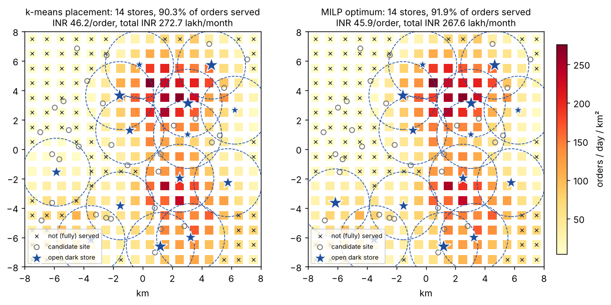
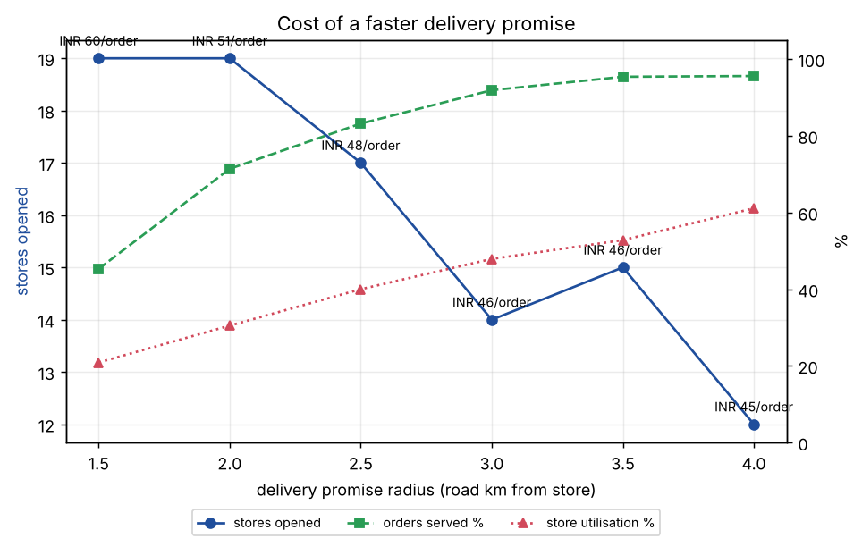

# Dark-Store Network Design


Where should a quick-commerce company open its dark stores (micro-fulfilment centres), and how many does it need, to deliver within about 10 minutes?

The model is a **capacitated facility location MILP** with a delivery-promise radius, solved with PuLP + CBC. Each month it trades off store rent, rider cost per order, and the revenue lost on orders that fall outside the promise.



## Results (16 km × 16 km city, ~18,000 orders/day, 45 candidate sites)

**Optimised vs. k-means placement** (3 km road radius, same number of stores)

| Design | Stores | Orders served | Avg. delivery km | Store utilisation | INR / served order | Monthly cost (INR lakh) |
|---|---:|---:|---:|---:|---:|---:|
| Demand-weighted k-means | 14 | 90.3% | 1.76 | 47.8% | 46.2 | 272.7 |
| **MILP optimum** | 14 | **91.9%** | 1.76 | 47.9% | **45.9** | **267.6** |

The MILP saves about **INR 5 lakh/month (~INR 61 lakh/year)** against a sensible clustering heuristic. It also picks the number of stores itself, while k-means had to be told k = 14 by the MILP.

**What a faster promise costs**

| Promise radius (road km) | 1.5 | 2.0 | 2.5 | 3.0 | 3.5 | 4.0 |
|---|---:|---:|---:|---:|---:|---:|
| Stores opened | 19 | 19 | 17 | 14 | 15 | 12 |
| Orders served | 45% | 71% | 83% | 92% | 95% | 96% |
| Store utilisation | 21% | 31% | 40% | 48% | 53% | 61% |
| INR / served order | 60.0 | 51.4 | 47.8 | 45.9 | 46.0 | 45.0 |



Cutting the radius from 3 km to 1.5 km raises the cost per order by about 30% and halves the share of the city that can be served. Each store's catchment shrinks faster than its rent does, so stores sit mostly idle. That is the structural reason ultra-fast delivery only pays off in very dense neighbourhoods.

## Model

```
min   Σ_j rent_j · y_j                                   monthly store cost
    + 30 · Σ_ij demand_i · (base + per_km · km_ij) · x_ij   rider + handling cost
    + 30 · Σ_i  demand_i · lost_margin · (1 − Σ_j x_ij)    unserved orders

s.t.  Σ_j x_ij ≤ 1                      each cell served at most once
      x_ij ≤ y_j                        only from open stores
      Σ_i demand_i · x_ij ≤ cap_j · y_j   store throughput (orders/day)
      x_ij = 0  if km_ij > R            delivery promise
      y_j ∈ {0,1},  0 ≤ x_ij ≤ 1
```

| Parameter | Value |
|---|---|
| Demand | 1 km² grid, 7 residential hot-spots + background, lognormal noise |
| Rent | INR 2.8–6.9 lakh/month, higher near the centre and for bigger stores |
| Capacity | 1,500 / 2,500 / 3,500 orders/day |
| Order cost | INR 18 handling + INR 9 per road-km |
| Lost order | INR 90 (contribution margin + churn risk) |
| Road distance | Euclidean × 1.3 circuity |

The k-means baseline clusters demand cells weighted by orders, snaps each centroid to the nearest free candidate site, and then gets the *optimal* assignment for those sites from an LP. So the gap above is purely the cost of choosing the wrong sites.

## Run it

```bash
pip install -e ".[dev]"
python run.py                 # about 10 s, writes results/
python run.py --radius 2.0
pytest -q
```

## Layout

```
src/darkstore/
  data.py    synthetic city, demand grid, candidate sites
  model.py   MILP (PuLP/CBC), fixed-site evaluator, k-means baseline
  plot.py    figures
run.py       reproduces the README results
```

## Possible extensions

* Single-sourcing (each cell served by exactly one store) as a binary assignment
* Isochrones from real road networks (OSRM) instead of a radius
* Multi-period expansion: which stores to open in year 1 vs year 2 as demand grows
* Demand uncertainty via scenario-based stochastic programming
